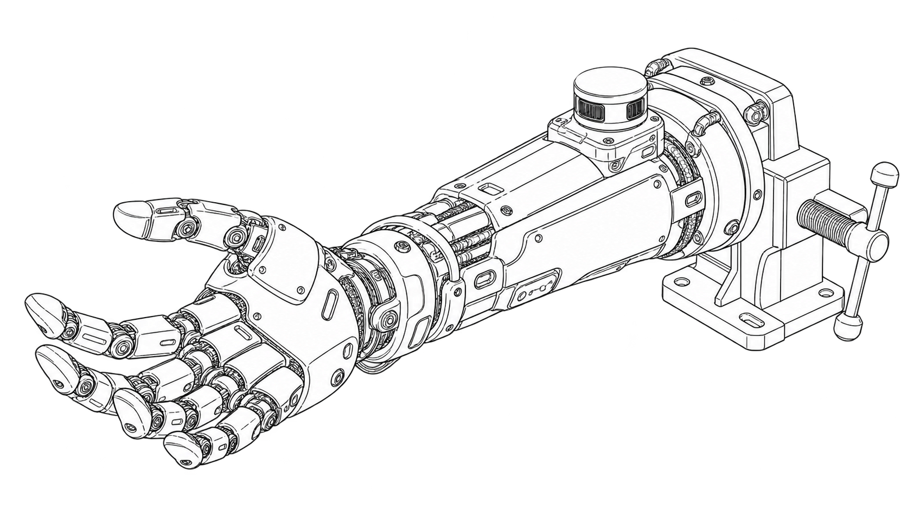
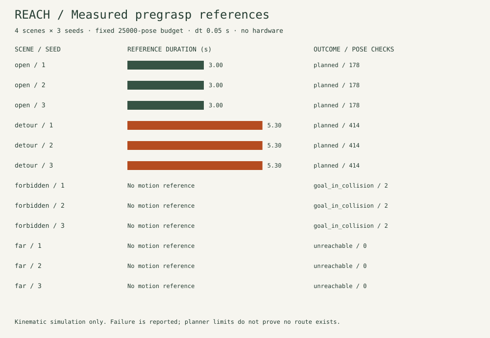

# LiDAR Bionic Arm for Search & Rescue



*Approved generated concept illustration. The pictured articulated hand is not the implemented mechanism.*

A runnable perception and pregrasp planning bench: a seeded 3D range scan becomes a point cloud, small-object clusters become candidate targets, and a four-joint arm plans a checked motion. The browser replays actual model output and exposes joint positions, rates, work counts and failure states. It never connects to hardware.

The software model has base yaw plus three pitch joints and a spherical hand/coupled-gripper proxy. It does not implement five fingers, object contact, grasp forces, person detection or a physical rescue arm. The search-and-rescue title describes the project direction; no rescue deployment or human attachment is claimed.

## Run the lab

Use Node.js 22 or 24. There are no runtime or development packages, paid services, keys, CDN assets or analytics.

```sh
npm ci --ignore-scripts
npm run check
npm start
```

Open <http://127.0.0.1:8801/>. Choose a scene and noise seed, then select **Run scan & plan**. Orbit the 3D projection, step or scrub the reference, inspect the joint table, and export the JSON report. Changing scene, seed or work budget clears the old result. Keep-out, unreachable and budget outcomes emit no motion reference. The text frame builder previews the control format; it opens no port.

`npm run build` produces a portable `dist/` static site; it can be served at an origin root with a local static server. The included server binds only loopback, serves an explicit file list, rejects write methods and sends a restrictive content policy. The core and lab work offline after the files are present. No journal, account or remote storage is used.

## What runs

1. Cast an80×40 first-return scan against fixed boxes and ground with seeded±1mm uniform noise. Each scan includes a proper sensor-to-base transform.
2. Transform to the base frame, remove the known ground/outside-bench points, voxelize at10mm, and extract35mm Euclidean connected components. A bounded neighbor search fails explicitly if work is excessive.
3. Select small, low clusters and place a pregrasp target120mm above their observed top. This is a geometric rule, not semantic object/victim recognition. The visible bounds are partial observations.
4. Solve analytic IK across yaw/signed-radial and elbow branches, including equivalent wrapped wrist pitch, and reject joint-limit violations.
5. Check direct and high-lift routes, then a finite seeded bidirectional RRT fallback. Planning uses **separately supplied conservative obstacle boxes and virtual keep-out volumes**. A partial cloud does not prove the rest of the scene safe.
6. Certify the whole joint interpolation with a Lipschitz link-displacement bound and conservatively inflated capsules. Check obstacles, floor/base fixture and nonadjacent self collision. Generate a quintic reference with zero endpoint velocity/acceleration and bounded joint speed/acceleration.

[Contract and work limits](docs/contract.md) · [Geometry/model data](docs/model.json) · [Preliminary hardware/build plan](docs/hardware.md) · [Control interface](docs/control-interface.md).

## Measured model runs



The recorded batch is four scenes × seeds 1, 2, 3, at 25,000 maximum pose evaluations and50ms reference samples. These are reference durations, not CPU benchmarks or physical trials.

| Scene | Outcomes across 3 seeds | Route | Pose evaluations per run | Reference duration |
| --- | --- | --- | --- | --- |
| Open reach |3 planned | direct |178 |3.00s |
| Raised fixture |3 planned | lift |414 |5.30s |
| Keep-out volume |3 goal_in_collision | none |2 |none |
| Beyond reach |3 unreachable | none |0 |none |

All six planned references remain below1rad/s and2rad/s². Null duration/rates in failures mean no motion was emitted. The limited batch demonstrates these controlled cases; it is not an accuracy, reliability or optimality study. An additional RRT regression uses a fixture that blocks the two initial route patterns: seed11 connects the exact endpoints in 25 waypoints with 3,093 pose evaluations, and every returned edge is checked.

```sh
npm run demo                 # record actual runs, CSV and SVG
npm run demo -- --check      # reproduce all three tracked outputs exactly
node scripts/cli.mjs run --scene detour --seed 2 --output arm-run.json
node scripts/cli.mjs packet --seq 1 --command S
node scripts/cli.mjs scan --input cloud.json --output clusters.json
```

CLI outputs refuse to overwrite existing files. Cloud import is a bounded2MiB regular UTF8 JSON file; see the [cloud schema](docs/control-interface.md#cloud-file). It processes observations only. It does not infer safe obstacle geometry or send a motion command. [Raw records](reports/scenarios.json) · [CSV](reports/scenarios.csv) · [Verification record](docs/verification.md).

## Validation and physical limits

Twenty tests cover FK/IK folded and wrapped poses, intermediate swept collisions, floor/self/joint constraints, direct/lift/RRT planning, work ceilings, deterministic scanning, transform reflections, sparse data, dense-cloud work rejection, measured success/failure cases, analytic trajectory limits, protocol CRC/freshness/lease expiry, bounded CLI files/no overwrite, and the actual loopback server. Cross-platform CI runs the same tests, static build and12-run reproduction on Node 22/24. Check the current [CI results](https://github.com/ungaaaabungaaa/lidar-bionic-arm-search-rescue/actions) for the commit you use.

This is a kinematic software bench. It has no real LiDAR driver, MCU firmware, servo output, ROS dependency, feedback/homing, payload torque, flex/backlash model, dynamic obstacles or force/contact control. Scan simulation omits beam divergence, multipath, motion distortion and robot self-occlusion. Conservative capsules/boxes can reject valid routes. Finite RRT failure does not prove impossibility. The model's geometric checks do not establish physical safety under uncertain calibration, sensing or actuation. Hardware assembly, reviewed electrical control, calibration and all physical tests remain pending.

## Method references

The clustering approach follows the connected-neighbor idea in the [official PCL Euclidean clustering tutorial](https://pointclouds.org/documentation/tutorials/cluster_extraction.html); this is an original JavaScript implementation with no PCL dependency. Quintic point-to-point timing is described by Northwestern's [Modern Robotics trajectory material](https://modernrobotics.northwestern.edu/nu-gm-book-resource/9-1-and-9-2-point-to-point-trajectories-part-2-of-2/) and its [official time-scaling reference](https://github.com/NxRLab/ModernRobotics/blob/master/packages/MATLAB/mr/QuinticTimeScaling.m). No upstream code or illustrations were copied. Those sources do not validate this arm or hardware.

## License and repository history

The original Apache-2.0 [LICENSE](LICENSE) is retained. New source uses the same license; see [NOTICE](NOTICE). The two earlier color-sensor sketches are preserved with all original history on `archive/before-lidar-arm-2026-10-27` at `7c8a9005c2cc54d0f9f4b47e0c0cafdc9c199cb5`. They are unrelated to the new arm implementation. The approved rename retains repository ID 769099550 and 18 stars observed at rename. This implementation was built on 27 October 2026; earlier stars/history are not evidence of earlier arm work. [Cover provenance](docs/images/cover-provenance.json) records the approved generated artwork. The portfolio site was not changed.

### Occluded-object experiment

Run `node scripts/cli.mjs run --scene occluded --seed 1`. This CLI/library scene places a wide panel between the sensor and the small object. The panel has visible returns but does not meet the small-object candidate rules, so the report contains `no_candidates` and no motion reference. At zero simulated noise, removing the hidden object leaves the scan exactly unchanged. This illustrates the limit of first-return observations; missing points do not prove unseen space is empty. Planning still requires separately supplied conservative obstacle envelopes. This is a synthetic case, with no physical sensing or rescue result.
